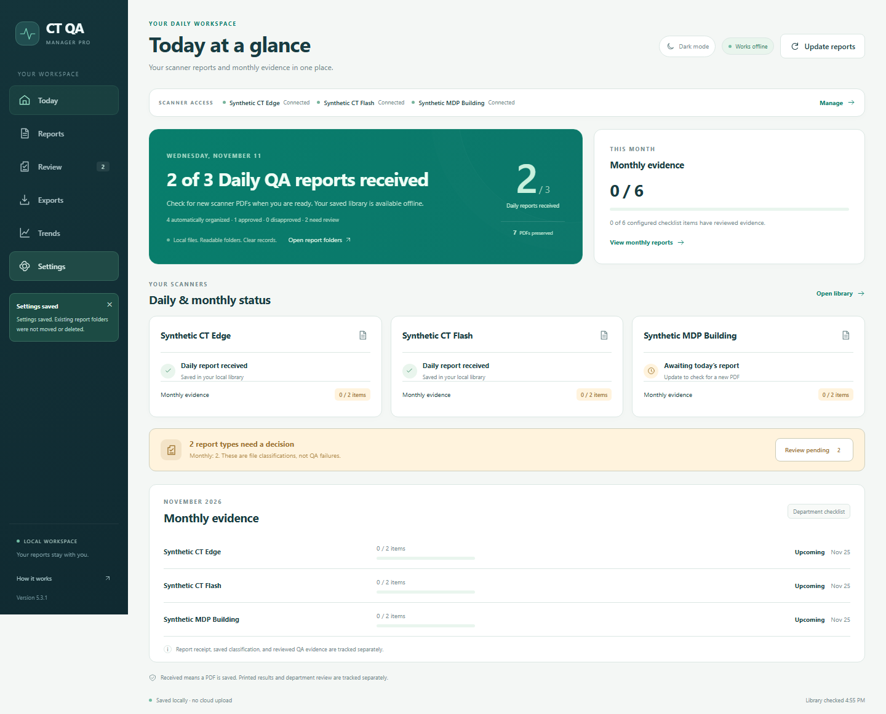

# CT QA Manager Pro 5.4.0

A portable offline HTML interface built on the original Windows archive, network, PDF and export modules. Run **Start CT QA Manager.cmd**. The local helper and runtime are bundled; the work computer needs no separate runtime installation or administrator launch. Its application policy must permit the included Windows x64 executable and local browser access.

[Download the program, offline update or upgrade helper from Releases](https://github.com/rtariq2015/QA-Manger/releases/latest).



The release includes an offline visual preview of the main workspace screens. These are actual Windows interface captures using synthetic data.

Version 5.3.0 integrates the portable Python PDF reader that passed the workstation compatibility test, alongside the Standard reader. Automatic starts with Standard, which was faster in the cold-reader comparison, and uses Python as an alternate when needed. The report inspector now shows current **water CT values and image-noise measurements**, their clearly printed HU bounds, Head/Body and slice context, and page references. Parenthesized references and unsupported multicolumn tables are not treated as current measurements. Reading and filing remain separate from clinical approval.

Existing successful PDF readings are preserved during the upgrade. With **Read and organize automatically** enabled, the eligible backlog starts after opening/importing and completed readings remain cached. Older Daily or Slice profiles receive one capability upgrade; already supported Basic water/noise caches remain reusable. Older unsupported templates can receive one compatibility refresh. Settings → Reading & filing provides Automatic, Portable Python and Standard readers. Stop suppresses automatic restarts for the current app session; changing the reader preference alone does not reread the library.

**Upgrading from version 5.2 or earlier:** use the **Upgrade ZIP**, extract it separately, close the program, run **Install update.cmd**, and select the existing program folder. This one-time step adds the Python runtime and updates the validator for its file types while retaining reports, sign-ins, settings and decisions. Normal in-app Update ZIPs are supported from version 5.3 onward.

Version 5.2.0 adds **Read report contents** for a selected PDF. It recognizes supported Siemens IEC basic and extended constancy layouts from their numbered test sections, extracts a consistent report-footer date, and shows literal printed observations with section references. It uses the bundled offline reader and needs no model download or AI subscription.

**Version 5.4 uses Automatic filing by default.** Complete supported Basic reports are filed as inferred Daily and Extended reports as inferred Monthly. Individual/combined IEC reports retain an available existing Daily/Monthly grouping. These are visible filing conventions, separate from reviewed QA evidence. Saved decisions, Undo, explicit report titles, conflicting evidence and scanner overrides retain priority. Under the selected scanner's **Report formats**, choose **Automatic, Ask me, Daily, Monthly or Other**. Legacy blank rules now use Automatic; explicit Ask me requests a manual choice. Verified dates can supply missing filing dates without rewriting the protected archive. Unsupported or conflicting files remain exceptions. Strictly identified reference documents file as Other and never supply current Daily/Monthly receipt or measurement trends; suspected reference documents remain exceptions and are excluded too.

Version 5.1.0 automatically organizes standard Daily reports and explicitly named Monthly documents, while preserving saved approvals, disapprovals and Undo. Only uncertain report types enter Pending. Automatic organization does not create a human approval or clinical PASS.

Repeat updates reuse unchanged readable copies and their index. Progress shows the current stage, counts and elapsed time, with safe cancellation at a checkpoint. Automatic background jobs clear their working indicator when they finish. The typing and unfinished-settings fixes from 5.0.1 remain included.

## The original program, with a new browser interface

**Today** shows Daily receipt, compact scanner connections and department Monthly evidence. **Reports** searches the saved library. **Review** provides a large, continuously scrolling PDF and simple Approve/Disapprove controls. **Exports** has its own scanner, month, year/multiple-year and document-type filters; each ZIP includes all matching PDFs, a readable summary and CSV inventory. **Trends** shows supported printed water CT, image noise and slice-thickness measurements with links back to their source pages. **Settings** groups connections, archive, reading, maintenance, updates and support. The Light/Dark appearance is saved with the portable workspace.

Unread reports are shown as waiting for background reading. Only processed exceptions enter the Review queue. Optional file decisions have two primary actions: **Approve** keeps the suggested type; **Disapprove** keeps the PDF as Other. The item leaves Pending and the next PDF opens. Undo remains available after a restart. No typed name, authorization checkbox, reason or second confirmation is required for sorting files. Approve, Disapprove and Undo reuse one validated dashboard and the committed organization state; their readable-folder refresh targets the selected PDF. The full response remains consistent without a second full dashboard reload.

These organization decisions are stored separately from clinical review. They do not manufacture a reviewer identity, printed PASS/FAIL or Monthly checklist evidence. Existing PDFs, reviewer names, selected evidence and archive history remain unchanged. The original interface remains available under Settings → Additional Windows tools, or through **Start CT QA Manager.cmd classic**, for detailed evidence review and legacy tools.

Background content reading processes one PDF at a time at lower process priority, yields between PDFs for foreground actions, and supports Pause/Resume and Stop. With automatic reading enabled, opening a configured workspace and completing an import can start the eligible queue without a reading-button click. Trusted work plans, compact per-file results and periodic overview/readable-folder checkpoints reduce repeated full-library work; each selected PDF still receives fresh path, archive-membership and byte-provenance checks. Use **Review → Read & organize automatically** for the pending queue, or **Settings → Reading & filing → Read all saved PDFs** to work through the remaining eligible library continuously. Automatic filing conventions and saved scanner overrides determine folder labels; uncertain files remain exceptions. The separate **Read next 20 saved PDFs** and targeted Trends actions retain their bounded batches. Completed readings are cached, and browsing a chart never starts a hidden full-archive read. CPU and network work still depend on the workstation and report sizes.

Trends keep scanner, Head/Body, system and slice contexts separate. Printed bounds and unusual values remain visible; ambiguous or conflicting readings are withheld. Change means the latest minus the first reading in the selected period, not a calibrated drift diagnosis or a clinical PASS. Eligible older reports receive a bounded one-time capability upgrade in the background queue. Supported Daily inline HU tables and explicitly labeled single-metric slice-thickness tables now contribute readings; ambiguous dual-source/shared-column layouts remain excluded. HU and millimetre metrics have separate units and series. Reference values are never substituted for current values.

The readable **Report Library** groups files by scanner/year/month/Daily/Monthly/Other. Protected original archives and earlier browsing copies remain preserved. Existing settings keep their archive location; opening a new extracted folder starts a separate workspace. Update the existing folder to retain its configuration and data.

## Offline and portable

The HTML, styles, icons, JavaScript, host and runtime are local files. No CDN, public website or cloud login is used. Scanner collection needs the hospital's internal network; saved reports and review work offline. Online services are disabled and nothing is uploaded automatically.

The Microsoft ASP.NET Core host listens only on 127.0.0.1 with an OS-selected port, same-origin checks and a per-run authenticated session. It invokes narrow PowerShell operations rather than arbitrary commands or file paths. Scanner passwords travel through local authenticated requests and process stdin, never URLs, command arguments or browser storage. Remembered passwords use Windows account/workstation protection and may need re-entry after moving to another computer.

The larger download contains the self-contained runtime. Runtime licensing notices are included with the host. Build dependencies are development-only; the Python reader and its libraries are bundled. Normal use requires no separate Python, Node, Git or SDK installation.

## Troubleshooting and printable support reports

Open **Settings → Backup & support → Support & activity**. **Export diagnostic ZIP** collects the retained structured activity and current diagnostic summary into one shareable file. **Open printable report** prepares a readable HTML report; open its dedicated link, then press **Ctrl+P** to print or save as PDF. The ZIP and printable-report links remain available while other operations finish.

The diagnostics describe program actions, timings, counts, reading and filing reasons, inferred filing bases, waiting-versus-exception states, parser support revisions and connection error numbers. They exclude PDFs, extracted report text, filenames, private paths, network addresses, usernames, passwords and raw logs. Nothing is uploaded automatically. Share the diagnostic ZIP when asking for troubleshooting help; the printable report is useful for a quick review.

The performance work follows bounded background-queue and checkpoint principles described in [Microsoft's channel documentation](https://learn.microsoft.com/en-us/dotnet/core/extensions/channels). PDF text and tables still require careful extraction: [pypdf's documentation](https://pypdf.readthedocs.io/en/latest/user/extract-text.html) explains whole-page parsing, layout and memory limits. These informed implementation choices; measured application checks determine performance claims.

## Build and validate

Build the Windows host with .NET 10 SDK:

```text
dotnet publish Host/CTQa.Host.csproj -c Release -r win-x64 --self-contained true -p:PublishSingleFile=true -p:IncludeNativeLibrariesForSelfExtract=true -p:DebugType=None -o App/Host
```

Distribute only CTQa.Host.exe plus its .NET/ASP.NET Core license and third-party notices in App/Host. The Windows workflow builds and uploads that exact tested host; the release publisher downloads it rather than rebuilding an untested executable. `scripts/build_release.py` produces clean portable, update and upgrade ZIPs, excluding development material and private profiles. A private configured package can be built locally with `--private-profile`; it must never be uploaded to the generic release.

Existing PowerShell regression suites remain. `Run-WebServiceTests.ps1` verifies no-name decisions, hash/stale checks, persistent Undo, readable copies, exported ZIPs, preserved clinical fields and offline worker transport. `Tests/Web/run-all.cjs` exercises the real host and adapter in a browser, including local-only assets, origin/auth rejection, PDF bytes, file decisions, filters, actual downloads, restart persistence and small-window layouts. Hosted checks do not establish hospital SMB access, endpoint approval or physical workstation behavior. See [testing details](docs/TESTING.md).

## Separate portable Python test

The [Python compatibility test](https://github.com/rtariq2015/QA-Manger/releases/tag/python-test-v1.0.0) is an optional, separate download. It bundles the Windows x64 Python runtime, a PDF reader and synthetic sample reports. Extract the complete folder and double-click **Run Python Test.cmd**. The results page and scrubbed JSON stay in its Results folder. No installer, administrator launch, pip, internet connection or PowerShell launcher is required for the test itself.

The dedicated Windows workflow checks the bundled interpreter under a temporary standard user, with installed Python excluded from PATH and Python environment variables deliberately pointing elsewhere. The reader blocks its own network operations. This application-level guard does not reproduce workplace endpoint controls; run the same ZIP on the work computer later to confirm those. The compatibility test leaves the main program and its data unchanged. Version 5.3 includes its own Python reader; an externally installed Python is never required.

The [native Windows test](https://github.com/rtariq2015/QA-Manger/actions/runs/42939047241) passed all **9 scenarios / 378 assertions**, including an actual standard-user launch, relocation, PDF reading, import isolation, private-output checks and input preservation. The [recorded evidence](Tests/PythonProbe/Summary.json) pins the tested source and download checksum. Workplace policy remains a separate check on the actual work computer.

[Workflow and performance decisions](docs/Performance-and-Workflow.html) · [Research and design rationale](docs/Redesign-Research.html) · [User guide](User%20Guide.html) · [Historical validation](Tests/Historical)
