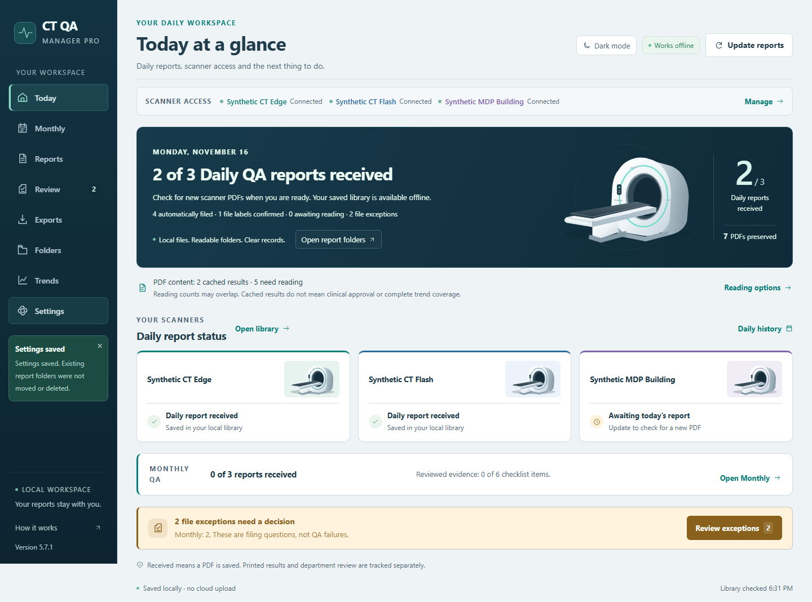

# CT QA Manager Pro 5.7.15

A portable, offline browser workspace for scanner QA reports. Extract the complete program folder and run **Start CT QA Manager.cmd**. The Windows x64 helper and PDF readers are included; the work computer needs no separate runtime installation or administrator launch. Its application policy must permit the included program and local browser connection.

> **Version 5.7.15:** refreshed Trends layout with scanner tabs, local Line/Points/Table views and selected-reading evidence. Monthly updates its saved view automatically while visible/idle and centers its scanner tabs.

> **Version 5.7.0 baseline:** a refreshed medical imaging-console design with bundled CT artwork, faster large-library browsing, improved readability and keyboard access, and stronger archive/update/restore validation. See the [source audit](docs/ENGINEERING-AUDIT.md), [release validation](docs/TESTING.md) and [developer guide](docs/DEVELOPMENT.md).

[Versioned downloads and visual previews](https://github.com/rtariq2015/QA-Manger/releases/latest) · [Quick guide](User%20Guide.html) · [Validation details](docs/TESTING.md)

## A simpler workflow

The eight workspaces are **Today, Monthly, Reports, Review, Exports, Folders, Trends and Settings**. Light/Dark appearance is remembered, and each scanner keeps a consistent accent color.

**Today** focuses on current Daily report receipt and scanner access, with one short Monthly summary. Detailed Monthly work has its own tab. **Reports** contains both the searchable library and the Daily receipt calendar; Today offers a calendar shortcut. Choosing a day carries its exact Daily scope into matching exports. Scanner schedules, activation dates and exclusions are respected, and future dates stay neutral.

**Monthly** separates three things: filed Monthly PDFs received, required test sections found in recognized cached PDF contents, and existing reviewed evidence. Choose a scanner and month, then configure the department checklist and due day directly. Checklist effective dates preserve historical versions, and unsaved setup edits survive background updates. Source links open the relevant report. Custom unmatched checklist labels, unread files and printed warnings remain visible. The view reads cached metadata and does not create clinical sign-off or start hidden PDF analysis.

**Review** has one visible decision area on the left and a large continuously scrolling PDF. In 5.7.1, distinct single-file decisions can queue while you read the next PDF. Sending, Queued and Saving indicators describe work still in progress; success and Undo follow the saved result and refreshed library. Failed or cancelled files remain available for review. Use the 5.7.1 Update ZIP to add this workflow. Its heading identifies the Current PDF or Selected reports. Checking a report also previews it; opening an unselected report clears the batch with a notice. Approve explicitly names Daily, Monthly or Other, and an uncertain target requires a choice. Select up to **50** reports, inspect the type breakdown, keep individual suggestions or choose one explicit type. Stale or changed members reject the batch before saving. **Undo** and durable **Undo batch** remain available. Optional Report details holds cached observations and the Read contents button.

Routine filing remains automatic for supported complete layouts: Basic IEC uses inferred Daily, Extended IEC uses inferred Monthly, and individual/combined IEC reports retain an available Daily/Monthly grouping. Saved decisions, explicit titles, scanner overrides, Undo and conflicts retain priority. These are document labels, separate from reviewed clinical evidence. Unsupported or conflicting PDFs can still need occasional review.

## Measurements with their source evidence

**Trends** supports eight metric families: water CT, image noise, slice thickness, light marker, external light marker, topogram position, sagittal/coronal alignment and table position. Values retain printed units, limits, context and exact source pages. Table position keeps **Continuous Move** and **Stepwise Move** separate for **Positions 1–4**, yielding eight distinct contexts without inventing directions, acquisition systems or slices. The entire supported table must validate before any of its readings are emitted. Reference and suspected-reference material remain excluded.

Trends distinguishes successfully read PDFs from availability of the selected measurement and context. A valid PDF without the selected test is not described as an unread file. Stable measurement revisions prevent identical background snapshots from restarting the same graph request; in-flight changes coalesce into a follow-up. A real new reading invalidates the displayed graph. Opening a chart or source link does not parse PDFs.

Automatic reading uses one disposable helper per PDF with verified archive membership, direct paths, byte hashes and metadata. Pause, Resume, foreground handoff, Stop intent, cancellation and bounded helper cleanup keep browsing available. Completed readings remain cached. Capability revision 4 targets older table-position sections; existing supported HU, noise, slice and alignment caches stay warm. The Standard reader remains the Automatic default, with bundled Python as an offline alternate. Background work still uses CPU and storage; local synthetic checks do not promise hospital-workstation throughput.

## Share reports or open ordinary folders

**Exports** prepares the reports matching its own filters. **Folders** opens the readable Report Library directly, with full-library export and full backup under secondary tools. The structure is **scanner → year → month → Daily / Monthly / Other**. Extracted report packages include an offline HTML summary and CSV; managers can browse the PDFs without the app. Full-library export leaves filtered Export selections intact. Store full backups on approved separate storage; restore uses a new folder.

## Settings, support and offline updates

Scanner connection profiles can supply paths and usernames; passwords are entered securely on the work computer. Remembered credentials are tied to the Windows account. Existing mappings are preserved. New installations contain example connection settings; configure real access locally.

Settings → Backup & support provides **Export diagnostic ZIP** and **Open printable report**. The ZIP contains retained structured actions, outcomes, timings, reading/filing counts and controlled reason codes, plus printable HTML and complete supported CSV/JSONL exports. Printable detail discloses its limits. PDFs, extracted text, filenames, private paths, usernames, passwords and raw logs are excluded. Nothing uploads automatically.

For an existing **5.3 or later** installation, choose the **Update ZIP** inside **Settings → Program updates**, then install and restart. Do not unpack it or manually overwrite program files. Reports, settings, saved sign-ins and decisions are preserved, with a previous-program backup. Versions 5.2 and earlier use the separate one-time **Upgrade ZIP**, extracted into a separate folder. Clean new installations use **Portable.zip**. Private configured packages are kept local and are never generic release assets.

The original Windows interface remains available through Settings for detailed legacy evidence tools. Keep the application and selected archive together when moving the workspace; a different Windows account/computer can require scanner sign-in again. Saved work is offline; scanner collection requires the workplace network. No service, scheduled task or online account is installed.

## Validation and development

Run `python Tests/Verify-Package.py` for static structure checks. The Windows workflow builds the self-contained host and pinned Python reader, runs native PowerShell suites, real Edge workloads, reader comparisons, background controls and WPF compatibility checks. Current evidence and generated screenshots are documented in [docs/TESTING.md](docs/TESTING.md); previous results remain under [Tests/Historical](Tests/Historical). Development and native execution are labeled separately. Hosted checks do not establish actual scanner connectivity or workplace endpoint approval.

The separate [portable Python compatibility test](https://github.com/rtariq2015/QA-Manger/releases/tag/python-test-v1.0.0) remains available. The application itself includes its readers and never requires installed Python, pip or Node on the work computer.
