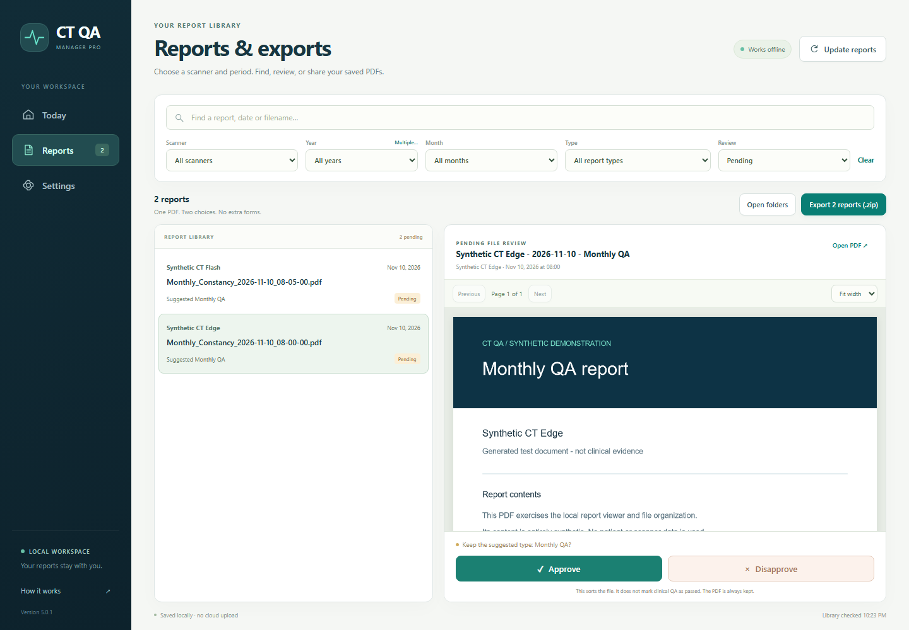

# CT QA Manager Pro 5.2.0

A portable offline HTML interface built on the original Windows archive, network, PDF and export modules. Run **Start CT QA Manager.cmd**. The local helper and runtime are bundled; the work computer needs no separate runtime installation or administrator launch. Its application policy must permit the included Windows x64 executable and local browser access.

[Download the program, offline update or upgrade helper from Releases](https://github.com/rtariq2015/QA-Manger/releases/latest).



The release includes an offline visual preview with Today, Reports and Settings screenshots. These are actual Windows interface captures using synthetic data.

Version 5.2.0 adds **Read report contents** for a selected PDF. It recognizes supported Siemens IEC basic and extended constancy layouts from their numbered test sections, extracts a consistent report-footer date, and shows literal printed observations with section references. It uses the bundled offline reader and needs no model download or AI subscription.

Under the selected scanner's **Report formats**, choose how each recognized layout is filed: Ask, Daily, Monthly or Other. The default is Ask because the supplied IEC documents do not themselves name a Daily/Monthly frequency. Saved decisions remain authoritative. Verified content dates can supply missing filing dates without rewriting the protected clinical archive. Unknown, conflicting and incomplete evidence remains visible for review; image-only PDFs still need OCR.

Version 5.1.0 automatically organizes standard Daily reports and explicitly named Monthly documents, while preserving saved approvals, disapprovals and Undo. Only uncertain report types enter Pending. Automatic organization does not create a human approval or clinical PASS.

Repeat updates reuse unchanged readable copies and their index. Progress shows the current stage, counts and elapsed time, with safe cancellation at a checkpoint. Automatic background jobs clear their working indicator when they finish. The typing and unfinished-settings fixes from 5.0.1 remain included.

## The original program, with a new browser interface

**Today** shows daily receipt, scanner status and department Monthly evidence. **Reports** combines PDF preview, scanner/year/month/type/status/search filters, whole-year or multiple-year selection, and prominent ZIP exports with a readable summary and CSV inventory. **Settings** holds scanner profiles/sign-ins, archive location, department settings, backups/restore, reading, offline ZIP updates and scrubbed support logs.

Pending file organization has exactly two primary actions: **Approve** keeps the suggested type; **Disapprove** keeps the PDF as Other. The item leaves Pending and the next PDF opens. Undo remains available after a restart. No typed name, authorization checkbox, reason or second confirmation is required for sorting files.

These organization decisions are stored separately from clinical review. They do not manufacture a reviewer identity, printed PASS/FAIL or Monthly checklist evidence. Existing PDFs, reviewer names, selected evidence and archive history remain unchanged. The original interface remains available under Settings → Additional Windows tools, or through **Start CT QA Manager.cmd classic**, for detailed evidence review and legacy tools.

The readable **Report Library** groups files by scanner/year/month/Daily/Monthly/Other. Protected original archives and earlier browsing copies remain preserved. Existing settings keep their archive location; opening a new extracted folder starts a separate workspace. Update the existing folder to retain its configuration and data.

## Offline and portable

The HTML, styles, icons, JavaScript, host and runtime are local files. No CDN, public website or cloud login is used. Scanner collection needs the hospital's internal network; saved reports and review work offline. Online services are disabled and nothing is uploaded automatically.

The Microsoft ASP.NET Core host listens only on 127.0.0.1 with an OS-selected port, same-origin checks and a per-run authenticated session. It invokes narrow PowerShell operations rather than arbitrary commands or file paths. Scanner passwords travel through local authenticated requests and process stdin, never URLs, command arguments or browser storage. Remembered passwords use Windows account/workstation protection and may need re-entry after moving to another computer.

The larger download contains the self-contained runtime. Runtime licensing notices are included with the host. Build dependencies are development-only; normal use requires no Python, Node, Git or SDK installation.

## Build and validate

Build the Windows host with .NET 10 SDK:

```text
dotnet publish Host/CTQa.Host.csproj -c Release -r win-x64 --self-contained true -p:PublishSingleFile=true -p:IncludeNativeLibrariesForSelfExtract=true -p:DebugType=None -o App/Host
```

Distribute only CTQa.Host.exe plus its .NET/ASP.NET Core license and third-party notices in App/Host. The Windows workflow builds and uploads that exact tested host; the release publisher downloads it rather than rebuilding an untested executable. `scripts/build_release.py` produces clean portable, update and upgrade ZIPs, excluding development material and private profiles. A private configured package can be built locally with `--private-profile`; it must never be uploaded to the generic release.

Existing PowerShell regression suites remain. `Run-WebServiceTests.ps1` verifies no-name decisions, hash/stale checks, persistent Undo, readable copies, exported ZIPs, preserved clinical fields and offline worker transport. `Tests/Web/run-all.cjs` exercises the real host and adapter in a browser, including local-only assets, origin/auth rejection, PDF bytes, file decisions, filters, actual downloads, restart persistence and small-window layouts. Hosted checks do not establish hospital SMB access, endpoint approval or physical workstation behavior. See [testing details](docs/TESTING.md).

## Separate portable Python test

The [Python compatibility test](https://github.com/rtariq2015/QA-Manger/releases/tag/python-test-v1.0.0) is an optional, separate download. It bundles the Windows x64 Python runtime, a PDF reader and synthetic sample reports. Extract the complete folder and double-click **Run Python Test.cmd**. The results page and scrubbed JSON stay in its Results folder. No installer, administrator launch, pip, internet connection or PowerShell launcher is required for the test itself.

The dedicated Windows workflow checks the bundled interpreter under a temporary standard user, with installed Python excluded from PATH and Python environment variables deliberately pointing elsewhere. The reader blocks its own network operations. This application-level guard does not reproduce workplace endpoint controls; run the same ZIP on the work computer later to confirm those. The compatibility test leaves the main program and its data unchanged. Python has not been added as a requirement for CT QA Manager.

[Research and design rationale](docs/Redesign-Research.html) · [User guide](User%20Guide.html) · [Historical validation](Tests/Historical)
