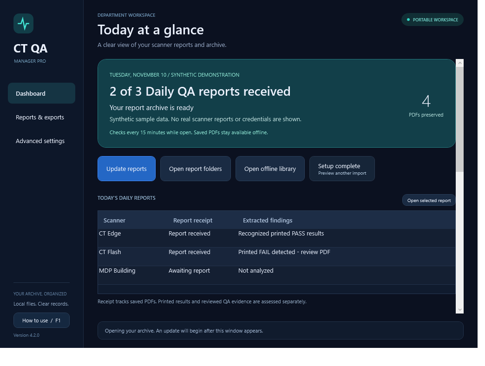
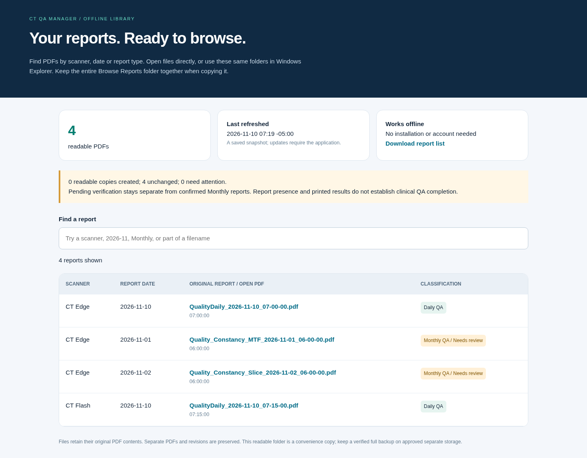

# CT QA Manager Pro 4.2.0

A portable Windows workspace for collecting, reviewing, finding and sharing CT QA report PDFs. Run it from one folder using the Windows PowerShell 5.1 and WPF components already supplied with Windows. No installer, administrator launch, Python, Git or external PowerShell modules are required for normal use.



*Native WPF preview rendered on hosted Windows with synthetic scanner data.*



*Actual browser screenshot of the generated offline library with synthetic PDFs. Both images use demonstration data.*

## Start on Windows

1. Choose **Code → Download ZIP** and extract the complete folder to a writable local location.
2. Double-click **Start CT QA Manager.cmd**.
3. Configure your approved scanner paths and usernames, then preview and confirm First-Time Setup.

The optional bundled PDF text reader needs .NET Framework 4.7.2+ already on the workstation. Follow IT approval/signing requirements. The application preserves execution policy and does not install or download components.

## Your everyday view

- **Today:** see which scheduled Daily PDFs were received, separately from extracted printed results. Provisional classification does not count as confirmed Daily receipt.
- **This month:** see reviewed checklist coverage, department due dates and missing evidence. One combined PDF or several separate PDFs can contribute reviewed items.
- **Local analysis:** extract explicit printed PASS/FAIL lines with page evidence. Unrecognized formats stay for review; no numerical tolerances or clinical decisions are invented.
- **Background checks:** optional checks every 5–240 minutes while the window is open, with local analysis in batches. Set interval to 0 to pause updates. Nothing runs after closing the app.
- **Find and export:** filter saved PDFs and create verified ZIP packages. Saved-report search stays available during scanner checks.
- **Protect:** check this computer, inspect free storage, verify saved PDFs or scanner source fingerprints, and create/restore a complete verified backup.

## All persistent workspace files together

```text
CT QA Manager/
  App/                         Program and bundled PDF libraries
  Config/
    Settings.json              Generic distribution baseline
    Settings.local.json        Your settings (created locally; ignored by Git)
    Credentials/               Optional Windows-protected sign-ins
  Data/                        New installations' default archive
    Reports/                   Managed, verified PDFs
    Browse Reports/            Ordinary PDFs for manual use
      Open Reports.html        Searchable offline library
      Report list.csv
      CT Edge/2026/11 November/
        Daily QA/
        Monthly QA/Confirmed/
        Monthly QA/Pending Verification/
    .ctqa/                     Index, reviews, recovery and cached analysis
  Backups/                     Verified backup destination / previous program
  Logs/
```

Readable PDFs can be opened, copied or dragged without the application. Copy the entire **Browse Reports** folder to keep offline links working. A full backup also preserves the application's metadata and review evidence. Choose approved separate storage for protection from drive failure.

New archives use a relative Data location so the folder can move. Existing custom archive locations are preserved. Close the app before moving it. Saved Windows sign-ins may need re-entry on another computer.

## Safe updates and recovery

For later updates, close the app and run **Update CT QA Manager.cmd** from your current installation, then select a separately extracted new release. The updater verifies App/launcher/guide checksums, preserves local settings and data, and keeps the previous program in Backups. The release's manifest is at `Tests/Repository-SHA256SUMS.txt`.

Use **Create full backup** to save a verified ZIP outside the live archive. **Restore to new folder** never overwrites an existing workspace and verifies all restored files. Backups include program files, configuration, reports, analysis and review metadata; saved credentials are excluded.

## Validation and evidence

The Linux cloud run passed **120 scenarios and 861 assertions** across seven suites. The hosted Windows run also passed **120 scenarios and 868 assertions**, including Windows DPAPI, native WPF loading and preview generation. A 10,000-record search benchmark measured **0.021 seconds** for a cached filter after **1.38 seconds** to build the index, including first compilation, on this Linux host. These are in-memory measurements, not workstation or SMB performance. Current Linux cloud and browser results are in [Tests/Current](Tests/Current). The [Windows workflow](https://github.com/rtariq2015/QA-Manger/actions/workflows/windows-validation.yml) runs native PowerShell 5.1 suites and a WPF demonstration capture on source changes. [Saved Windows evidence](Tests/Current/Windows) identifies the validated source commit and run. These hosted checks do not establish hospital access or interactive workstation DPI behavior.

Actual hospital access, scanner authentication, endpoint restrictions and interactive DPI acceptance still require workstation validation. See [testing and limitations](docs/TESTING.md) and the [Windows checklist](Tests/Windows-Smoke.md).

[User guide](User%20Guide.html) · [Siemens QA reference](App/Reference/Siemens_QA_Guide.html) · [Changes](CHANGELOG.md) · [Development](CONTRIBUTING.md)

HTML guides are best viewed after downloading. The repository uses generic connection placeholders. Keep real reports, local configuration, credentials and logs out of Git. No project license has been selected; bundled libraries retain their own licenses and notices in `App/Lib/PdfPig`.
