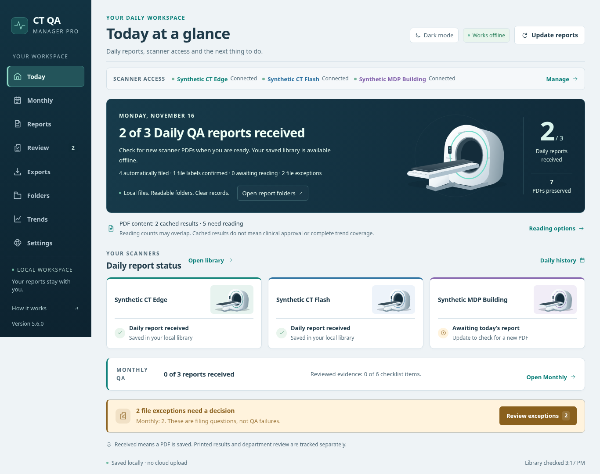
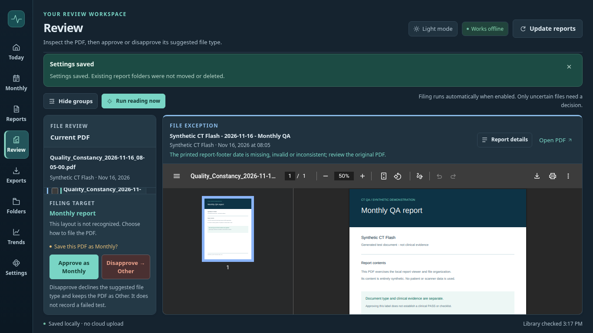

# Engineering interface previews

These are actual Linux Chromium captures of the local host with generated demonstration PDFs, not hospital photographs or design mockups. They show the unreleased imaging-console interface in both themes, with brand-neutral CT gantry artwork embedded as local SVG. Some captures retain real progress notifications. Linux uses its browser PDF fallback; native Windows viewer captures and final-source outcomes are provided by the pull request’s Windows validation artifacts. These images do not establish actual Windows DPI or workplace approval.

| Workspace | Light | Dark |
| --- | --- | --- |
| Today | [View](images/engineering/today-light.png) | [View](images/engineering/today-dark.png) |
| Monthly | [View](images/engineering/monthly-light.png) | [View](images/engineering/monthly-dark.png) |
| Reports | [View](images/engineering/reports-light.png) | [View](images/engineering/reports-dark.png) |
| Review | [View](images/engineering/review-light.png) | [View](images/engineering/review-dark.png) |
| Exports | [View](images/engineering/exports-light.png) | [View](images/engineering/exports-dark.png) |
| Folders | [View](images/engineering/folders-light.png) | [View](images/engineering/folders-dark.png) |
| Trends | [View](images/engineering/trends-light.png) | [View](images/engineering/trends-dark.png) |
| Settings | [View](images/engineering/settings-light.png) | [View](images/engineering/settings-dark.png) |

Nonempty PDF-derived Trends at the effective 200% viewport: [Light](images/engineering/trends-readable-light-200.png) · [Dark](images/engineering/trends-readable-dark-200.png). The plot keeps 13 CSS-pixel labels with local horizontal panning, while exact values and source links remain in the table.

